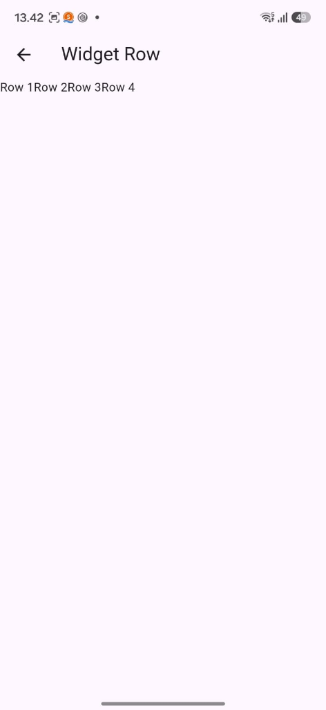
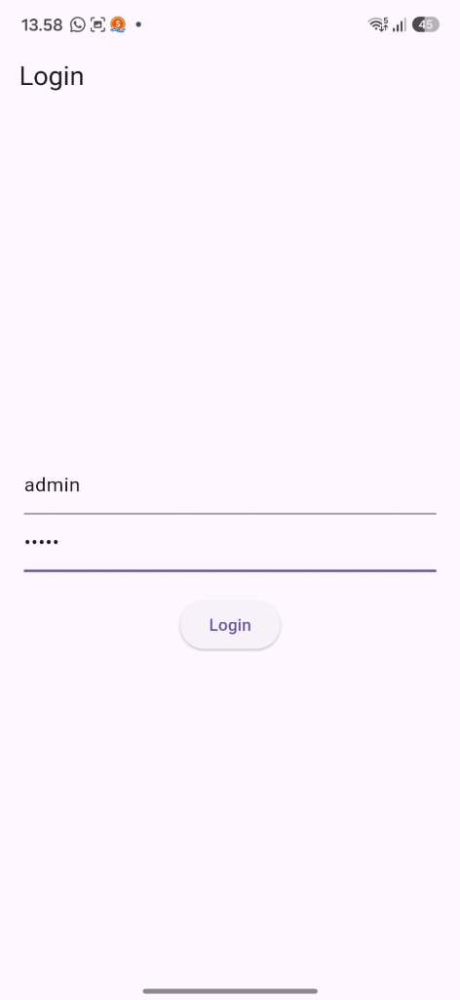
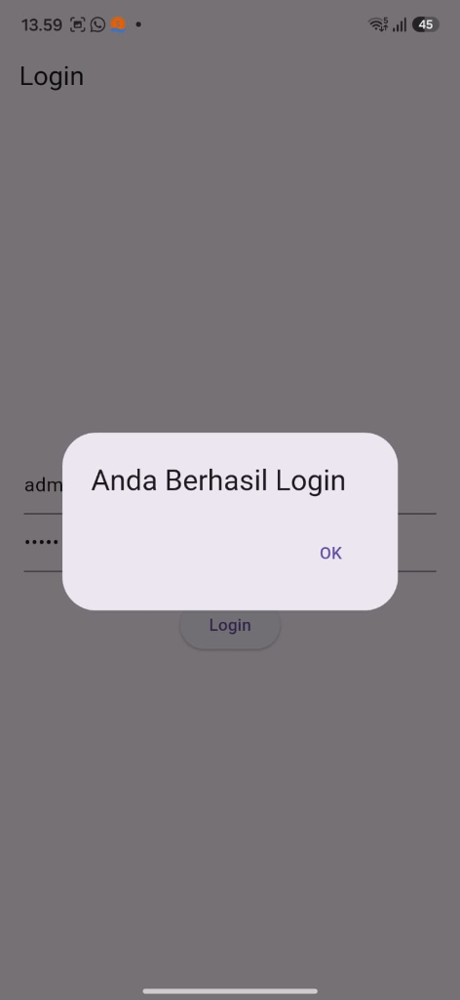
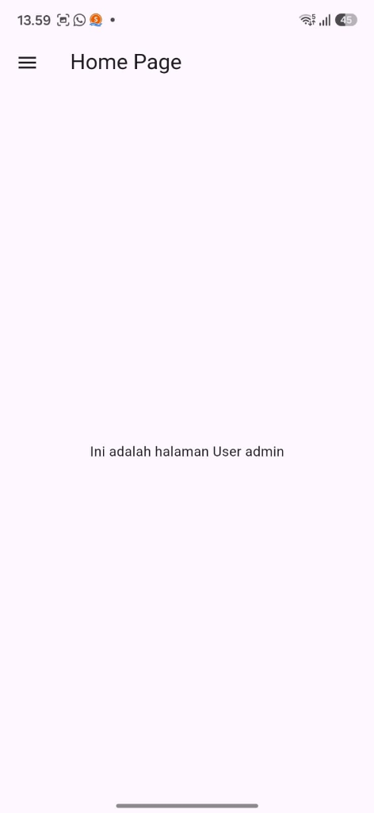
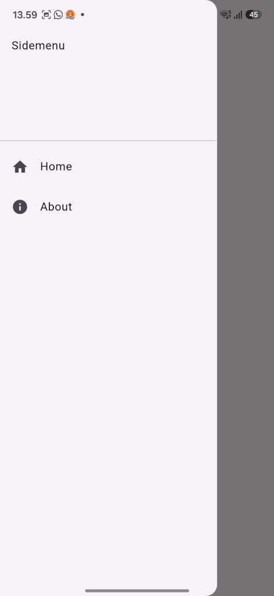

# Tugas Pemrograman Mobile

- **Nama**: Nayli Ghassaniy Latifatun Nida
- **NIM**: H1D024058

---

## Modul 2 - Pengenalan dan Desain Framework Flutter

### Screenshot Hasil Modul 2

| Hello World | Widget Column | Widget Row |
| :---: | :---: | :---: |
|  |  |  |

| Form Produk | Detail Produk | List Data Produk |
| :---: | :---: | :---: |
|  |  |  |

---

## Modul 3 - Routes, Side Menu, Login dan Local Storage

### Screenshot Hasil Modul 3

| Login Page | Alert Login | Home Page |
| :---: | :---: | :---: |
|  |  |  |

| Sidemenu | About Page |
| :---: | :---: |
|  |  |
